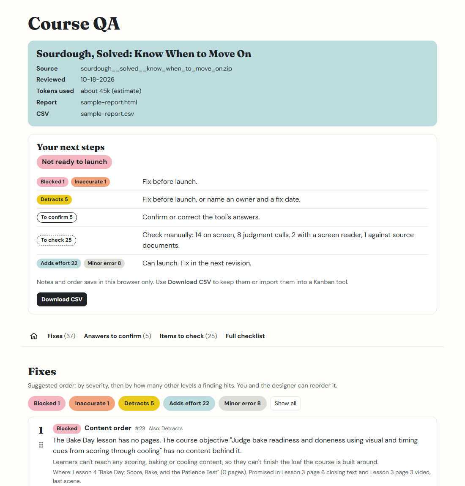
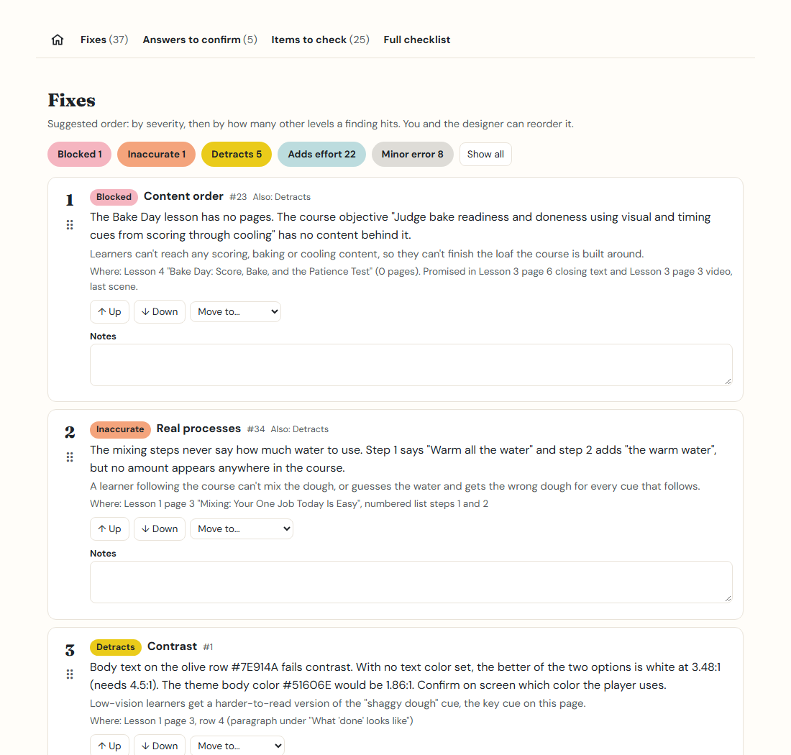

# learner-first-qa

A Claude skill that reviews an eLearning course or slide deck against the **Learner-First UX/LX Checklist** and hands
back a checklist a person validates.

**New to this?** The [website](https://chickadee368.github.io/learner-first-qa/) has a step-by-step
[getting-started guide](https://chickadee368.github.io/learner-first-qa/guide.html) for the Claude desktop app,
claude.ai and Claude Code, and a [live sample report](https://chickadee368.github.io/learner-first-qa/sample-report.html)
you can click through.



## What it does

You give it an exported course or a PowerPoint deck. It reads everything a learner would see and hear, checks it
against 53 criteria covering accessibility and learning design, and writes two files:

- **An HTML report** with a launch call, your next steps, and every finding ranked by severity. You can filter by
  level, reorder the list, and add notes.
- **A CSV** you can import into a Kanban tool such as Trello, Jira, Asana, Notion or Monday.

It answers what it can from the files. When it isn't sure, it drafts an answer for you to confirm. Anything it can't
check from the files, like keyboard use or how a screen reader sounds, is left open for a person, with a note on
what to look at. It never pretends to answer what it can't check.

## Severity is judged by the learner

Every finding gets one level, chosen by asking how it affects the learner:

| Level | What it means for the learner | Launch |
|---|---|---|
| **Blocked** | They can't access the content. | Must be fixed before launch |
| **Inaccurate** | The content is wrong, and following it could cause a mistake on the job. | Must be fixed before launch |
| **Detracts** | They get less of the content, or a worse version of it, than other learners. | Fix before launch, or name an owner and a fix date |
| **Adds effort** | They get the same content but have to work harder for it. | Can launch; fix in the next revision |
| **Minor error** | Something is incorrect but doesn't block understanding. Each one wears down trust. | Can launch; fix in the next revision |

Wrong content in a high-stakes area is always Inaccurate: money, legal and compliance, safety and security, anything
client-facing, and steps that can't be undone.

The full checklist, with every criterion and who checks it, is in
[checklist.md](plugins/learner-first-qa/skills/course-qa/checklist.md).

## What it can read

- **HTML course exports** (.zip or folder). So far it has been tested with one authoring tool's web export, so
  exports from other tools may not be read fully. If it doesn't recognize an export, it tells you and asks before
  trying.
- **PowerPoint decks** (.pptx), including charts, SmartArt, speaker notes and embedded video. Tested on a handful of
  decks so far; tables and grouped shapes haven't been tested yet.

It needs the exported file. You can't give it a link to a course, such as a review link or a share link from your
authoring tool. (It does visit the links inside a course, to check that they work.)

## What you need

You can run it in any of these. All three were tested and give the same core findings.

- **The Claude desktop app or claude.ai:** nothing to install besides the skill. Code execution must be turned on
  (Settings → Capabilities). It was tested on a Claude Pro plan.
- **[Claude Code](https://claude.com/claude-code):** also needs [Node.js](https://nodejs.org) 18 or later, which
  runs the small scripts the skill uses.

So far it has been tested on Windows. It should work on a Mac, but that hasn't been tested yet.

## Install

**Claude desktop app or claude.ai.**

1. Download `course-qa.zip` from this repo's
   [Releases](https://github.com/chickadee368/learner-first-qa/releases). Don't unzip it.
2. In Claude, open **Settings**. Under **Customize**, choose **Skills**, then **Add → Upload skill**, and pick the
   zip. Skills belong to your account, so uploading once makes it available in both the desktop app and claude.ai.
3. Check that code execution is on in **Settings → Capabilities**.

Uploaded skills also show up in the Claude mobile app, but the mobile app hasn't been tested, and attaching a course
and reading the report are easier on a computer.

**Claude Code, as a plugin.** In Claude Code, run:

```
/plugin marketplace add chickadee368/learner-first-qa
/plugin install learner-first-qa@learner-first-qa
```

**Claude Code, as a folder.** Copy the `plugins/learner-first-qa/skills/course-qa` folder into your skills folder:
`~/.claude/skills/` on Mac, or `C:\Users\<you>\.claude\skills\` on Windows.

## Running a review

1. Start the review.
   - **Desktop app or claude.ai:** start a new chat, attach your course .zip or .pptx, and type "Review this course
     with the course-qa skill."
   - **Claude Code:** open Claude Code in the folder that holds your course file. Type `/learner-first-qa:course-qa`
     if you installed the plugin, or `/course-qa` if you copied the folder. (Plugin commands always start with the
     plugin's name.) Then give it the course file's name.
2. Answer the optional question about the course (key vocabulary, product names, who the learners are), or type
   "skip."
3. It shows how many words the course has and roughly how many tokens the review will use. To cancel, press
   **Esc** in Claude Code or click stop in the app.
4. When it's done:
   - **Desktop app or claude.ai:** the report opens in a preview panel. Download the HTML file and open it in your
     browser to add notes, reorder findings and export the CSV; those only work in the downloaded copy.
   - **Claude Code:** the HTML report and CSV are saved in the same folder. Running the same course again on the
     same day adds a number to the file name, so earlier reports are never replaced.

In the app, Claude asks your permission before visiting the links in your course. It may also ask permission to run
commands in its workspace while it builds the report. Those only touch Claude's own working files, not your
computer.

Notes and reordering in the report save in your browser only. Use **Download CSV** to keep them or move them into
your Kanban tool.



## See an example

[examples/sample-report.html](examples/sample-report.html) and [sample-report.csv](examples/sample-report.csv) come
from a short sourdough baking course made for testing. Its flaws are real, including a lesson left empty. Download
the HTML file and open it in your browser to try the filters and reordering.

## Privacy

- **Your course content is sent to Claude** as part of the review, the same as anything else you share in a Claude
  chat. Check your organization's rules before reviewing internal or confidential courses.
- **To check that links work, it tries to visit each link in the course.** Visiting a link doesn't send any
  course content. In the app, it asks your permission first. If it can't visit them, the report lists the links
  for you to check.
- **Nothing else leaves your computer.** The skill doesn't track usage or report back to anyone, and the report
  works offline: it doesn't load anything from the web.

## Time and tokens

A three-lesson course (about 9,000 words) took 4 to 6 minutes in testing. Most of that time is Claude reading the course and writing
up findings, so bigger courses take longer. The token estimate shown at the start is based on how much text the
course has, and it's a rough guide.

## Credits and license

Created by [Chelsea Taylor](https://www.linkedin.com/in/chelseataylor).

- **Code** (scripts and report template): [MIT License](LICENSE).
- **Checklist and severity levels:** [CC BY 4.0](LICENSE-CONTENT). Use and adapt them however you like, with credit.

Report fonts: Fraunces and DM Sans, used under the SIL Open Font License 1.1 (license files are in the skill's `fonts` folder).
